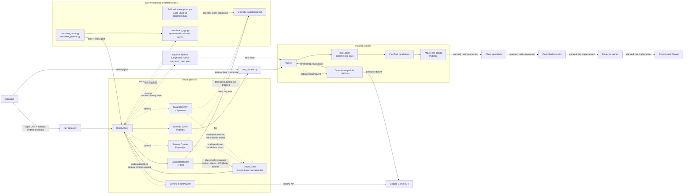

# GateCounsel Current Implementation: Logical Structure

> **Purpose:** a code-grounded map of what is in the repository now. The standard recon-to-plan path is solid. Dashed paths are optional integrations, paths with weaker controls, or stages still planned. This diagram is deliberately separate from the desired MVP map in [Target MVP Architecture](TARGET_MVP_ARCHITECTURE.md).

**Snapshot reviewed:** `main` at `6e8ca76` (13 October 2026).  
**Planning references:** [MVP Roadmap](GATECOUNSEL_MVP_ROADMAP.md), [Full Project Roadmap](GATECOUNSEL_FULL_PROJECT_ROADMAP.md), [Detailed Project Description](GateCounsel_Project_Detailed.md), and the prior [Current Project State and MVP Next Steps](CURRENT_PROJECT_STATE_AND_MVP_NEXT_STEPS.md).

## 1. Current-state summary

The repository currently implements a **recon → plan** prototype. It can crawl a supplied target, produce a typed site map, generate a deterministic prioritized plan, and optionally use an LLM to suggest recon paths or rerank existing plan tasks. The recon and planner can be invoked separately or joined in a small LangGraph graph.

The executable pipeline stops at `AttackPlan`. There is no expert dispatcher, exploit executor, evidence verifier, finding/report pipeline, policy gate, full-run manager, or GitHub Actions workflow. The Compose lab currently contains Juice Shop only. The local tests use a separate Python mock app.

## 2. Current logical structure



### Diagram legend

- **Solid line:** standard implemented code path or data contract.
- **Dotted/dashed line:** optional integration/caller, a path with weaker controls, or a planned stage. Read the label to distinguish them.
- **Target:** `run_recon.py` accepts an operator-supplied target. The code does not restrict it to the Compose host.
- **Guard:** in the current design, the HTTPX path gets a pre-request check; the dashed browser/Katana paths should not be interpreted as proof that all their network traffic is blocked by the guard.

## 3. Actual end-to-end flows

### Flow A: recon only

1. `run_recon.py` accepts a target, optional extra scope entries, optional credentials, output path, crawl limits, RPS, and optional Playwright/Katana/Gemini switches.
2. `ReconAgent` creates a `ScopeGuard` from the target plus any extra `--scope` values. If no explicit scope is passed through the API, the target itself becomes the allow-list.
3. `ScopedHttpClient` is used for reachability, BFS crawl, common API guesses, optional Gemini-nominated GETs, authentication attempts, protected-endpoint checks, and reflection probes.
4. Recon aggregates discovered endpoint data, auth observations, technology hints, crawl counters, and notes into the Pydantic `SiteMap`.
5. `run_recon.py` serializes the site map JSON and prints a summary.

### Flow B: planning from an existing site map

1. `run_planner.py` loads and validates a site-map JSON file.
2. `RuleEngine` creates candidates and assigns priorities/risk labels.
3. `AttackPlanner` applies the configured minimum priority and task cap. If credentials are available and LLM is not disabled, it may send a task digest to a configured OpenAI-compatible endpoint.
4. LLM output may drop or rerank existing task IDs and revise rationales within a priority delta. Unknown IDs are ignored; no new tasks are accepted.
5. The planner serializes `AttackPlan` JSON. This is a plan only; it is not an execution or a finding.

### Flow C: combined LangGraph run

`orchestration/graph.py` provides a graph with `START → recon → planner → END`, plus recon-only graph setup. The `build_full_graph_stub()` function does not add specialists, execution, verification, or reporting; it currently wires only recon and planning.

## 4. Repository map with source links

| Area | Files and links | Current role |
|---|---|---|
| Public overview | [`README.md`](../README.md) | Concept, planned workflow and MVP scope. Some implementation status statements are stale. |
| Recon orchestration | [`recon_agent.py`](../agents/recon/recon_agent.py), [`run_recon.py`](../run_recon.py) | Runs recon phases and exposes the CLI. |
| Recon contracts and HTTP | [`models.py`](../agents/recon/core/models.py), [`http_client.py`](../agents/recon/core/http_client.py) | Pydantic site-map schema and the scope-aware HTTPX wrapper. |
| Recon crawlers | [`crawler.py`](../agents/recon/crawlers/crawler.py), [`browser_crawler.py`](../agents/recon/crawlers/browser_crawler.py), [`katana_crawler.py`](../agents/recon/crawlers/katana_crawler.py) | HTTP BFS crawl, optional Playwright observation, optional separate Katana subprocess. |
| Recon scanners/planner | [`param_probe.py`](../agents/recon/scanners/param_probe.py), [`auth_detector.py`](../agents/recon/scanners/auth_detector.py), [`fingerprint.py`](../agents/recon/scanners/fingerprint.py), [`gemini_planner.py`](../agents/recon/planners/gemini_planner.py) | Reflection/API probes, auth observations, technology signatures, optional Gemini path proposals. |
| Scope check | [`scope_guard.py`](../safety/scope_guard.py) | Host allow-list, optional port matching, optional DNS answer check, and optional JSONL audit. |
| Attack planner | [`planner.py`](../agents/planner/planner.py), [`rule_engine.py`](../agents/planner/engine/rule_engine.py), [`plan_models.py`](../agents/planner/models/plan_models.py), [`llm_client.py`](../agents/planner/client/llm_client.py), [`run_planner.py`](../run_planner.py) | Deterministic class scoring plus optional LLM reranking and plan serialization. |
| Graph | [`graph.py`](../orchestration/graph.py) | Recon-only and recon-to-planner LangGraph graph definitions. |
| Lab | [`docker-compose.yml`](../lab/docker-compose.yml), [`validate_juiceshop.py`](../scripts/validate_juiceshop.py) | Juice Shop Compose target and manual recon validation script. |
| Tests | [`test_recon.py`](../tests/test_recon.py), [`test_planner.py`](../tests/test_planner.py), [`mock_app.py`](../tests/mock_app.py) | Unit/CLI/mock-server integration tests; 51 test methods found. Tests were not run for this architecture review. |
| Training-data examples | [`generate.py`](../training_data/generate.py), [`data_idor.py`](../training_data/data_idor.py), [`data_open_redirect.py`](../training_data/data_open_redirect.py), [`data_sqli.py`](../training_data/data_sqli.py), [`data_ssrf.py`](../training_data/data_ssrf.py) | Produces JSONL prompt/response examples for four classes; no model is trained or loaded here. |
| Future expert design | [`EXPERT_AGENTS_SPEC.md`](../agents/experts/EXPERT_AGENTS_SPEC.md) | Specification only. The `agents/experts/` directory contains no expert implementation. |
| Local planning documents | [`MVP roadmap`](GATECOUNSEL_MVP_ROADMAP.md), [`Full roadmap`](GATECOUNSEL_FULL_PROJECT_ROADMAP.md) | Git-ignored plans used for this current-vs-target comparison. |

## 5. Current components: behavior and rules

### 5.1 Recon CLI and `ReconAgent`

**Technology:** Python, Pydantic, HTTPX, Beautiful Soup, optional Playwright, optional Katana binary, optional direct Gemini API, optional LangGraph wrapper.

**Current sequence:**

1. Reachability GET to `<target>/`.
2. HTTPX breadth-first crawl of same-origin pages up to `max_pages` and `max_depth`.
3. Optional Katana discovery.
4. Common GET probes for API descriptions, robots, sitemap, health/version paths, and common API prefixes.
5. Optional Gemini suggestion of extra relative GET paths; suggestions are structurally validated and fetched by the HTTPX client.
6. Auth surface detection. If credentials are provided, the agent attempts a bounded set of generic login forms/JSON endpoints and then revisits some pages.
7. Optional browser pass for client-side routes, request observations, cookies, and local storage.
8. Header/body fingerprint aggregation.
9. Bounded GET reflection probes using a generated marker plus context characters.

**Recon rules:**

- The HTTP crawler follows only URLs with the exact same origin as the initial target and filters static extensions.
- It records form fields and methods but does not automatically submit discovered forms during ordinary crawl.
- API-surface and model-suggested recon requests are GET-only.
- Reflection probes target GET query parameters and a limited number of candidates.
- Login POST attempts happen only when the operator supplies both username and password.
- The `max_pages`, `max_depth`, `max_reflection_probes`, per-request timeout, and HTTPX RPS cap bound parts of the run, but there is no shared maximum-request or run-time budget across all network components.

**Output:** `SiteMap` JSON. It is a map/hypothesis input for planning, not a finding report.

### 5.2 `ScopeGuard` and HTTPX path

**Technology:** pure Python URL parsing, `socket.getaddrinfo`, `ipaddress`, JSONL audit, and HTTPX.

**Current guard rules:**

- Accepts only `http` and `https` request URLs.
- Checks whether the parsed host exactly matches a registered host; optional subdomain matching is off by default.
- If the registered target includes a port, checks that port. If no port was registered, its documented behavior allows any port on that host.
- Optional `pin_dns` records DNS answers at registration and checks for overlap on later lookups; it defaults to off and does not bind the subsequent HTTPX socket to the checked IP.
- Optional audit JSONL records allow/deny decisions, including the full requested URL.
- The HTTPX wrapper checks the requested URL before sending and checks each redirect destination before following it. It also rate-limits its own requests and caps response-body bytes.

**Important implementation gaps:**

- Scheme is not stored as part of the allow-list entry; registering a host over HTTPS does not constrain later checks to HTTPS.
- There is no run expiry, allowed-method set, CIDR policy, network egress enforcement, or request/time budget in the guard.
- HTTPX TLS certificate verification is disabled for recon clients.
- The CLI target is automatically added to scope, so the code does not enforce “local lab only.”

### 5.3 Playwright path

**Technology:** Playwright Python, Chromium, headless context; HTTPS errors are ignored in the browser context.

**Current behavior:** checks whether the initial URL and discovered anchors pass the `is_allowed` callback, captures `request` and `response` events, and collects local storage/cookies/JWT-like strings. The callback records a scope decision but does not abort disallowed requests. The callback is observation and result filtering, not a request interceptor.

**Result:** useful SPA reconnaissance capability, but it does not currently satisfy the design claim that every browser request is blocked before reaching the network. It should not be treated as a safe executor path yet.

### 5.4 Katana path

**Technology:** optional external ProjectDiscovery Katana executable launched by Python `subprocess.run` with a bounded timeout and command-line depth/rate/time settings.

**Current behavior:** the adapter checks the initial target, asks Katana to use an exact-origin crawl-scope expression, then checks parsed output URLs before inserting them into the site map. Network requests are made by the separate process, not by the Python HTTPX client through a shared broker.

**Result:** optional discovery backend only; its output filter is not equivalent to GateCounsel controlling every request.

### 5.5 Planner and priority rules

**Technology:** Python rule engine, Pydantic contracts, optional HTTPX OpenAI-compatible client. Gemini-compatible endpoint is the default configuration; a custom `LLM_BASE_URL` can point elsewhere.

**Class list:** `sqli`, `xss_reflected`, `jwt_misconfig`, `auth_bypass`, `idor`, `ssrf`, and `open_redirect`.

**Candidate rules in `RuleEngine`:**

- **SQLi:** require at least two of a SQLi-prone parameter name, numeric example, or reflection observation.
- **Reflected XSS:** GET parameter is marked reflected.
- **IDOR:** identifier-like name or `_id` suffix plus numeric/UUID/type evidence; auth and reachability add signals.
- **Open redirect:** parameter name matches a redirect-destination hint set.
- **SSRF:** parameter name matches a server-fetch/URL hint set.
- **JWT:** a JWT observation creates one candidate; decoded sensitive/PII claims, missing `exp`, or localStorage add signals.
- **Auth bypass:** protected or auth-required URLs produce access-control candidates.

**Scoring:**

```text
priority = round(100 × class_impact × likelihood)
likelihood floor = 0.30; cap = 0.95
bands: critical >= 80; high >= 60; medium >= 40; low < 40
```

Impact coefficients currently are SQLi `.95`, reflected XSS `.55`, JWT `.90`, auth bypass `.90`, IDOR `.80`, SSRF `.85`, and open redirect `.50`. Class risk defaults to `needs_review` for SQLi, SSRF, and auth bypass; the other classes default to `safe_probe`; any non-GET task becomes `needs_review`.

**LLM reranking rules:** only the top 30 existing candidates are sent; the reply can adjust priority within ±20, drop an existing task, and rewrite its rationale. It cannot add a task. Model use is optional and falls back to deterministic planning on failure.

**Known scoring nuance:** `_TaskAccum.add()` prevents duplicate signal text but still increments likelihood for repeated signals. Shared reachability evidence can therefore add score more than once on a multi-parameter endpoint.

### 5.6 Data contracts and orchestration

- `Param`, `FormInfo`, `Endpoint`, `AuthInfo`, `TechHint`, `CrawlStats`, and `SiteMap` are in [`agents/recon/core/models.py`](../agents/recon/core/models.py).
- `PlanTask`, `PlanSummary`, and `AttackPlan` are in [`agents/planner/models/plan_models.py`](../agents/planner/models/plan_models.py).
- The graph state is dict-shaped. `recon_node` emits `sitemap`; `planner_node` validates it and emits `plan`.
- Contracts are structured but not yet redacted at a central persistence boundary. `Param.examples`, `FormInfo.hidden_values`, snippets, and task URLs can contain values that need review before being persisted or sent externally.
- The current task risk tier is metadata only because no executor consumes it. `safe_probe` does not mean execution is authorized.

## 6. Current outputs and artifacts

| Artifact | Produced by | Meaning and limitation |
|---|---|---|
| `sitemap.json` | `run_recon.py` | Endpoint, parameter, authentication, technology, and crawl observations. Not a security finding. The output path is ignored by Git by default. |
| `plan.json` | `run_planner.py` | Candidate testing tasks. No test has been executed and no issue is confirmed. The checked-in sample targets `server.vulnapp.id`; there is no authorization record in the repository. |
| Scope JSONL | Optional `--audit-log` | Guard decisions for URLs checked by Python guard. It does not represent every browser/Katana action. URLs may contain query data. |
| Training JSONL | `training_data/generate.py` | Fine-tuning examples for four classes if the generator is run. No training/inference stage uses them. Generated `*.jsonl` files are Git-ignored. |
| Test output | `unittest` modules | Coverage against an ephemeral local mock app; tests have not been run in this review. |

## 7. Technologies: actual dependency picture

| Technology | Current use | Version/configuration state |
|---|---|---|
| Python | All implementation | Python version is unspecified; no `pyproject.toml` or lockfile. |
| Pydantic | Site-map and plan schema validation | `pydantic>=2.7`; minimum range only. |
| HTTPX | Guarded recon requests and direct LLM API calls | `httpx>=0.27`; the recon client sets `verify=False`. |
| Beautiful Soup 4 | HTML parsing | `beautifulsoup4>=4.12`. |
| Playwright Python | Optional browser recon | `playwright>=1.45`; browser install and lifecycle instructions are not in a project setup guide. |
| LangGraph | Optional state graph | `langgraph>=0.2`; orchestration currently includes recon and planning only. |
| Rich | CLI formatting | `rich>=13.0`, with plain output fallback. |
| Gemini / OpenAI-compatible API | Optional LLM path suggestions and planner reranking | Direct API use through HTTPX; no RAG, model registry, or packaged offline runtime. |
| Docker Compose | Juice Shop local service | `bkimminich/juice-shop:latest`, host port bound to `127.0.0.1:3000`, ordinary bridge network. |
| Katana | Optional route crawler | External binary, skipped when not installed. |
| `unittest` | Tests | Python standard library; 51 test methods located, not executed for this review. |

`requirements.txt` contains minimum versions for HTTPX, Beautiful Soup, Pydantic, Playwright, LangGraph, and Rich. `run_recon.py` directly imports `urllib3` without declaring it in that file. No reproducible environment command is documented.

## 8. Present but not connected to the pipeline

- `lab/docker-compose.yml` provides Juice Shop, but no GateCounsel runner service, custom target, health check, reset/seed step, or internal egress-disabled network.
- `tests/mock_app.py` exercises recon and planner logic, but it is a test fixture rather than the planned Docker benchmark.
- `scripts/validate_juiceshop.py` is a manual check; its reachability probe uses HTTPX directly before the guard is instantiated.
- `training_data/` is content/data preparation, not RAG, model training, or expert inference.
- `agents/experts/EXPERT_AGENTS_SPEC.md` and the roadmap describe future expert designs; the directory has no executable expert code.
- The tracked `plan.json` is a generated candidate plan, not test evidence. It should not be used as a command or target authorization.

## 9. Missing stages compared with the target MVP

| Desired stage | Current equivalent | What is missing |
|---|---|---|
| Versioned scope policy | `ScopeGuard(targets=...)` | Full typed policy with scheme/host/port/address/method/expiry/budgets/authorization record. |
| Isolated reproducible custom lab | Juice Shop Compose + test mock | Custom app, seeded XSS/IDOR cases, reset, health check, pinned image/build, internal runner network. |
| One broker for all traffic | `ScopedHttpClient` for HTTPX only | Browser request abort/interception, Katana containment, shared per-run budget and central audit. |
| XSS/IDOR-only typed planning | Seven-class `RuleEngine` | MVP profile that enables exactly two classes and class-specific specialist contracts. |
| Reasoning-only specialists | Markdown spec only | Implemented XSS/IDOR components, schema validation, dispatch, graceful failures. |
| Controlled execution | None | Small operation set, brokered requests, no arbitrary tool commands. |
| Evidence verification | None | Positive/negative lab criteria and `confirmed`/`rejected`/`inconclusive` results. |
| Sanitized reports and deterministic gate | None | Canonical finding JSON, Markdown view, redaction, policy result and exit code. |
| Full local/CI run | Separate recon and planner commands; partial graph | One command, artifact packaging, GitHub Actions, and unconditional cleanup. |

## 10. Current architecture versus target architecture

| Topic | Current implementation | Target MVP |
|---|---|---|
| Primary result | Site map and candidate attack plan | Verified finding report and deterministic gate decision |
| Target | Any operator-supplied URL can be added to scope; Compose offers Juice Shop | One custom local target with explicit authorization and no public egress |
| Classes | Seven planned classes in rule engine | Reflected XSS and IDOR only |
| Network controls | HTTPX checks allow-list; browser/Katana have separate paths | One request broker and guard for all requests/navigation/redirects |
| Planning | Rule engine plus optional hosted-compatible reranker | Deterministic MVP rules; optional model does not control execution |
| Execution | None | Narrow, brokered, class-specific operations |
| Verification | None | Evidence-based XSS and two-user IDOR verifiers |
| Output | `sitemap.json`, `plan.json` | Sanitized `report.json`, `report.md`, artifacts, `GateDecision` |
| Infrastructure | One local Juice Shop service | Custom target + runner on isolated Compose network, then cleanup |
| Automation | Tests and manual script | One local command and GitHub Actions lifecycle |

For the intended build order and acceptance gates, see [Target MVP Architecture](TARGET_MVP_ARCHITECTURE.md). The [Current Project State and MVP Next Steps](CURRENT_PROJECT_STATE_AND_MVP_NEXT_STEPS.md) records the broader static audit and discrepancies.
