# GateCounsel MVP Roadmap — Fast, Safe, End-to-End

> **Maintained plan:** update this roadmap whenever the agreed MVP scope, architecture, or acceptance criteria change. Keep it aligned with [Target MVP Architecture](TARGET_MVP_ARCHITECTURE.md). Last reviewed: 2026-10-16.

## 1. MVP objective

In the shortest practical time, build a demonstrable DevSecOps pipeline that tests one deliberately vulnerable application and lab-only SSRF sentinel inside Docker, blocks all out-of-scope target traffic, uses AI assistance in bounded reconnaissance, candidate planning, and expert reasoning for reflected XSS, IDOR, SQL injection (SQLi), SSRF, and open redirect, runs a brokered Exploit Agent, verifies evidence, and uses a Report Agent to produce a CI-friendly report and decision. Deterministic policy, validation, execution, verification, and gate decisions remain authoritative; expert proposals are constrained to harmless lab operations and destinations.

The MVP proves the architecture across these five vulnerability classes. It does **not** need a full dashboard, additional classes, a large RAG corpus, fine-tuning, or public-target scanning. A small, reviewed, class-specific retrieval set for each of the five expert profiles is included; the large corpus and fine-tuning remain deferred.

## 2. Fixed MVP scope

| Area | MVP decision |
|---|---|
| Target | One custom deliberately vulnerable demo application and one lab-only SSRF sentinel in Docker. OWASP Juice Shop is optional only after the MVP passes. |
| Classes | Reflected XSS, IDOR, SQLi, SSRF, and open redirect. Each must have seeded positive/negative lab cases and class-specific deterministic verification. |
| Agent logic | Deterministic planner plus Tier 1 model-and-RAG expert profiles for all five classes, a bounded Exploit Agent, and a Report Agent. AI assists recon, candidate planning, and expert reasoning; Exploit Agent uses fixed operations, and Report Agent uses verified results only. |
| Recon | Bounded same-origin browser crawl plus AI-suggested relative GET paths from a sanitized structural inventory. Every suggested path is validated and fetched only through the ordinary scope-guarded broker. |
| AI assistance | AI in recon, planning, and the five class-specific expert profiles is an MVP capability. Recon/planning retain deterministic fallback; invalid or unavailable expert output never dispatches a test and is recorded for review. The MVP release must include a recorded provider-backed demonstration of all three AI-assisted stages; ordinary CI remains repeatable with a deterministic fake provider. |
| Execution | Exploit Agent delegates approved operations to one executor behind one request broker. |
| Safety | Isolated Docker network, explicit `ScopePolicy` for GateCounsel requests, request/timeout budget, redirect validation, audit log, and target-side SSRF restricted to the sentinel. |
| Output | Report Agent writes canonical JSON and Markdown from verified findings and run context; sanitized screenshots/logs are artifacts. |
| DevOps | Docker Compose plus a GitHub Actions workflow that starts, tests, collects artifacts, and destroys the lab. |
| UI | No dashboard. Use FastAPI OpenAPI docs or a CLI command. |
| Expert knowledge retrieval | Small, reviewed local collections for XSS, IDOR, SQLi, SSRF, and open redirect expert RAG; local ChromaDB is the planned implementation. A large RAG corpus and fine-tuning/LoRA are deferred. |

## 3. MVP architecture

```mermaid
flowchart LR
    Dev[Developer or CI] --> Run[CLI / workflow]
    Run --> Compose[Docker Compose lab]
    Run --> Policy[Versioned ScopePolicy]

    subgraph Runner[GateCounsel runner]
        Recon[Bounded Recon]
        Inventory[Sanitized structural inventory]
        ModelClient[ModelClient]
        Suggestions[Relative GET path suggestions]
        ValidatePaths[Validate schema, scope and budget]
        SiteMap[Typed SiteMap]
        Rules[Deterministic candidate rules]
        Candidates[Candidate tasks]
        PlannerReview[AI planning review]
        ValidatePlan[Validate existing IDs and bounds]
        Tasks[Validated five-class tasks]
        Experts[Five class-specific expert profiles]
        Verdicts[Typed class-specific ExpertVerdicts]
        ExploitAgent[Bounded Exploit Agent]
        Executor[Fixed-operation executor]
        ExecResult[ExecutionResult JSON<br/>status + sanitized evidence]
        Verifier[Evidence verifier]
        Findings[Verified findings]
        Gate[Deterministic policy gate]
        GateDecision[GateDecision]
        ReportAgent[Report Agent]
        Report[Canonical JSON and Markdown]
        CIAdapter[CI result adapter<br/>maps GateDecision to exit status]
        CIStatus[GitHub Actions check<br/>summary + status]
    end

    subgraph TargetBoundary[Target request boundary]
        Guard[ScopeGuard]
        Broker[RequestBroker]
        Target[Isolated demo target<br/>five seeded vulnerability classes]
        Sentinel[Compose-only SSRF sentinel]
    end

    subgraph ModelPlane[Separate model service plane]
        ModelEndpoint[Local model or allowlisted provider gateway]
    end

    Compose --> Recon
    Compose --> Target
    Compose --> Sentinel
    Policy --> Guard
    Recon --> Inventory --> ModelClient
    ModelClient <-->|sanitized JSON| ModelEndpoint
    ModelClient --> Suggestions --> ValidatePaths --> Broker
    Recon -->|bounded crawl| Broker
    Broker --> Guard
    Guard --> Broker
    Broker <-->|approved target traffic only| Target
    Target -->|fixed SSRF test route only| Sentinel
    Broker -->|read-only sentinel evidence query| Sentinel
    Broker --> SiteMap --> Rules --> Candidates --> PlannerReview
    PlannerReview --> ModelClient
    ModelClient --> ValidatePlan
    Candidates -. deterministic fallback .-> ValidatePlan
    ValidatePlan --> Tasks --> Experts --> Verdicts --> ExploitAgent
    ExploitAgent --> Executor --> Broker
    Executor --> ExecResult --> Verifier --> Findings
    Findings --> Gate --> GateDecision
    Findings --> ReportAgent
    GateDecision --> ReportAgent
    ReportAgent --> Report --> Artifacts[Sanitized artifacts and cleanup]
    GateDecision --> CIAdapter
    Report --> CIAdapter
    CIAdapter --> CIStatus
    CIStatus --> Dev
    Artifacts --> Dev
```



**Network boundary:** ModelClient is a separate model-service path, not a target-request path. Prefer an isolated local OpenAI-compatible inference endpoint. If a hosted provider is explicitly enabled, its provider hostname must be separately allowlisted for model traffic; it must never broaden the runner's target-network permissions. Model output cannot bypass ScopePolicy or the RequestBroker.

## 4. MVP repository layout

```text
gatecounsel/
├── app/
│   ├── models.py
│   ├── scope_guard.py
│   ├── request_broker.py
│   ├── recon.py
│   ├── planner.py
│   ├── experts.py
│   ├── exploit_agent.py       # allowlisted operation coordinator
│   ├── executor.py            # narrow brokered operation helpers
│   ├── verifier.py
│   ├── report_agent.py        # verified finding to report package
│   ├── reporter.py            # JSON/Markdown rendering helpers
│   └── cli.py
├── demo-target/
│   ├── Dockerfile
│   ├── app/                       # intentionally vulnerable, documented lab only
│   └── ground_truth.json
├── lab/
│   ├── compose.yaml
│   └── scope-policy.yaml
├── tests/
│   ├── unit/
│   ├── safety/
│   └── e2e/
├── artifacts/                     # ignored by Git
├── .github/workflows/mvp.yml
├── docs/
├── pyproject.toml
└── README.md
```

## 5. The two-person work split

Both people review contracts together before coding. Keep all integration through Pydantic models, never through informal dictionaries.

| Owner | Primary responsibility | First integration hand-off |
|---|---|---|
| Person A | Docker lab, custom demo target, Scope Guard, request broker, CI workflow, safety tests | Working `ScopePolicy` and a reachable in-network target. |
| Person B | Pydantic models, recon, rule planner, expert agents, Exploit Agent, verifier, Report Agent and report renderer | A typed `SiteMap`, sample plans, verified finding and report package. |
| Both | Contract review, end-to-end test, report wording, demo, benchmark labels | A successful `run-demo` command and CI artifact. |

Do not divide the project into two separate applications. Integrate every two or three days.

## 6. Implementation plan — ten working days

### Day 1 — Agree the contracts and safety rules

Create these models first:

- `ScopePolicy`
- `Endpoint` and `SiteMap`
- `ReconSuggestion` (relative path and short reason; no URL authority or request instructions)
- `TestTask`
- `PlannerReview` (candidate ID, keep/drop, bounded priority adjustment, short rationale)
- `RunMetadata` (provider/model, prompt/schema version, AI mode, fallback status; no keys or sensitive prompts)
- `AttackPlan` (planner container for validated `PlanTask` candidates)
- `ExpertVerdict` (one per target parameter; includes proposed test input, placement/encoding, expected success signal, rationale, confidence, auth requirement, model tier/name, and retrieved-source audit trail)
- `ExecutionRequest` (allowlisted operation sent by the Exploit Agent to the executor)
- `ExecutionResult` (per-task status plus sanitized evidence records/references returned to the verifier; no finding verdict)
- `Evidence`
- `Finding`
- `GateDecision`
- `ReportInput` (verified findings, evidence references, run metadata, and gate decision)
- `ReportPackage` (canonical report JSON and its Markdown rendering)

Write `docs/mvp-scope.md` stating:

- only the `demo-target` and `ssrf-sentinel` Compose service hostnames are allowed, with the sentinel available only for its fixed SSRF test route and read-only evidence endpoint;
- no public IPs, external DNS names, arbitrary internal destinations, or production targets;
- the run has a small request/depth/time budget;
- test evidence and logs are sanitized;
- the target is intentionally vulnerable and locally owned.

**Done when:** invalid schemas fail unit tests and the scope document is accepted by both teammates.

### Day 2 — Build the laboratory

Person A creates `lab/compose.yaml` with:

- `demo-target` service;
- `ssrf-sentinel` service, reachable only on the internal lab network;
- `gatecounsel` service;
- one internal network;
- a target health check;
- no external target required;
- an output volume for sanitized artifacts.

Person B creates the project shell, CLI skeleton, test setup, and sample data contracts.

The demo target must include a seeded, documented positive case and negative control for each of the five classes:

- reflected-input scenario for XSS;
- cross-identity object ownership scenario for IDOR;
- harmless boolean-result scenario against seeded records for SQLi;
- server-side fetch to the Compose-only sentinel for SSRF;
- redirect to a pre-registered destination inside the isolated lab for open redirect.

Never use a public destination, metadata service, real user data, or destructive database operation as a test case.

Record expected safe evidence criteria in `demo-target/ground_truth.json`; do not rely on memory.

**Done when:** Compose starts the target and sentinel, health checks pass, and GateCounsel resolves only the approved Compose service names. The target can reach the sentinel only for the controlled SSRF test, with public egress denied.

### Day 3 — Make scope enforcement real

Implement `ScopeGuard.authorize()` and make the request broker the only GateCounsel-originated outbound client. Separately restrict the vulnerable target's outbound network access to the fixed SSRF sentinel route; deny public egress.

Minimum checks:

- scheme and hostname exactly match policy;
- resolved destination belongs to the expected internal network/address range;
- port and HTTP method are permitted;
- redirects are checked again;
- request count and run timeout are bounded;
- every allow/block decision is logged with its reason.

Add tests for a valid in-network URL, an external URL, an invalid scheme, a redirect, and budget exhaustion.

**Done when:** the safety-test suite proves that disallowed destinations are rejected before a request is made.

### Day 4 — Bounded AI-assisted recon

Use Playwright for Python to visit only allowed pages and collect:

- URLs and HTTP methods observed;
- links and forms;
- parameter names and source (path/query/form);
- basic authentication-state labels;
- browser screenshots/trace references when useful.

Keep it bounded: one host, small depth, page limit, short timeout. Write a `SiteMap` JSON artifact. Add the recon AI assist: send only a minimal, sanitized structural inventory (paths, methods, status/content-type summaries, parameter names and coarse auth labels) to the configured model provider and accept at most eight proposed relative paths. Reject schemes, authorities, query strings, fragments, traversal, duplicates, and non-GET suggestions. The recon agent must revalidate every accepted path with the same scope policy and fetch it through the RequestBroker. Never send credentials, parameter values, raw response bodies, or personal data. When AI is disabled or fails, continue the deterministic crawl and record the fallback state.

**Done when:** the demo target produces a stable expected `SiteMap`; tests cover valid and invalid model suggestions, scope rejection, request-budget accounting, and deterministic fallback.

### Day 5 — Planner and specialist interfaces

Build a deterministic planner that creates candidate tasks such as:

- reflected user-controlled input in a known rendering context → XSS specialist candidate;
- object-like identifier plus controlled authorization context → IDOR specialist candidate;
- database-backed input with a known seeded fixture → SQLi specialist candidate;
- server-side URL-fetch input with a fixed sentinel destination → SSRF specialist candidate;
- redirect destination input with a lab-registered destination → open-redirect specialist candidate.

The planner's `AttackPlan` contains the validated `PlanTask` candidates. The matching class-specific expert returns a Pydantic `ExpertVerdict` for every target parameter in its task. The verdict describes the proposed test input, encoding and injection point where relevant, expected success signal, confidence, short reasoning, alternate proposals, auth requirement, model tier/name, and retrieved sources. It is an unexecuted test proposal: specialists have no target network access, and the Exploit Agent must validate all fields against the original task and fixed harmless lab operation/destination allowlists before dispatch.

For the MVP, use Tier 1 model-plus-RAG expert profiles for all five classes with a small curated knowledge collection for each; defer fine-tuning and a large corpus. If the expert provider is unavailable or its response is invalid or outside the allowlist, do not execute that task; retain it for review and continue reporting the run state.

Add the planning AI assist after rule generation. It may keep or drop existing candidate IDs, adjust their priority by at most 20 points from the deterministic score, and supply a short rationale. It must not add candidates or change a candidate's class, endpoint, method, parameter set, operation, or safety tier. Validate the response against a typed schema and candidate-ID allowlist before applying it. Use a deterministic fake `ModelClient` in unit/CI tests; unavailable, malformed, or rejected model output preserves the deterministic plan. The provider receives only the sanitized candidate digest needed to rank tasks, never credentials or raw evidence.

**Done when:** fixture site maps produce predictable task and plan JSON with AI enabled, disabled, unavailable, and given invalid output; AI can only reorder/drop bounded candidates, while the rule-only result remains available as fallback.

### Day 6 — Exploit Agent and verifier

Implement the Exploit Agent as the only stage that dispatches test operations. It consumes a validated expert `ExpertVerdict`, verifies its task ID, class, endpoint, method, and parameter against the originating `PlanTask`, and maps only an allowlisted harmless lab proposal to a finite class-specific `ExecutionRequest`. SQLi checks use seeded records and non-mutating operations; SSRF checks can reach only the Compose sentinel; open-redirect checks accept only a pre-registered destination in the isolated lab. It cannot create arbitrary commands, accept unknown payloads or destinations, or bypass policy. The underlying executor sends every action through the RequestBroker and ScopeGuard, including redirect revalidation.

The executor returns an `ExecutionResult` JSON object with the task/operation status and sanitized observations or evidence references. The verifier consumes that result with the class-specific lab criteria and emits a `Finding` JSON object linked to its `Evidence`. The Exploit Agent does not set the final finding verdict.

The verifier must use class-specific, explicit rules:

- XSS is confirmed only by an agreed browser-side execution signal in the controlled lab.
- IDOR is confirmed only by evidence that an unauthorized test identity accessed an object it should not own in the controlled lab.
- SQLi is confirmed only by a deterministic, non-mutating result difference against known seeded records; do not extract unrelated data or modify records.
- SSRF is confirmed only when the lab sentinel records the unique request made by the target-side fetch behavior; do not contact public services, cloud metadata, or arbitrary internal hosts.
- Open redirect is confirmed only when the response points to a destination pre-registered inside the isolated lab; do not follow or navigate to external destinations.

Response status codes or model confidence alone never confirm a finding.

Store sanitized request metadata, response metadata, timestamps, and a screenshot/trace reference as `Evidence`.

**Done when:** positive demo cases return `confirmed`; equivalent negative controls return `rejected` or `inconclusive`.

### Day 7 — Report Agent and policy gate

The JSON handoff contracts (`ExecutionRequest`, `ExecutionResult`, `Evidence`, `Finding`, `GateDecision`, `ReportInput`, and `ReportPackage`) are defined in the [Target MVP Architecture glossary](TARGET_MVP_ARCHITECTURE.md#plain-language-definitions-for-the-pipeline-contracts).

Build a deterministic Report Agent that receives one typed `ReportInput` JSON object containing verifier-produced findings, sanitized evidence references, run metadata, and the gate result. It must not invent, confirm, suppress, or rewrite findings or verdicts. There is no direct Exploit Agent → Report Agent call: the coordinator passes the verifier's `Finding` records and the gate's `GateDecision` to the Report Agent.

After report generation, the coordinator maps `GateDecision` to the CI process status: `pass` exits `0`; `warn` exits `0` in the MVP's default non-blocking mode and adds a review note; `fail` exits nonzero. A required GitHub Actions check can then block merge, and a downstream deployment job can depend on the gate result. The workflow publishes a run summary and uploads reports for the responsible person; targeted email/chat/PR notifications are outside the MVP.

Implement:

- `ReportPackage` serialized as `report.json`, the canonical report package;
- `report.md` rendered from that canonical JSON record;
- a separate deterministic gate over verified findings: `fail` only for a confirmed finding with complete evidence, otherwise `warn` or `pass`.

Include run ID, target profile, scope-policy ID, class, verdict, evidence references, remediation summary, ASVS reference where suitable, and the gate decision. Redact authentication headers, cookies, passwords, tokens, and personal data before writing files.

**Done when:** every report entry traces to a verifier-produced finding and evidence reference, the Markdown matches canonical JSON, and the gate result is deterministic.

### Day 8 — End-to-end local workflow

Create one command, for example `python -m app.cli run --profile lab/mvp`, that:

1. validates policy and AI-provider configuration without weakening target scope;
2. waits for the target health check;
3. performs recon;
4. plans tasks;
5. invokes the Exploit Agent, which dispatches only approved class-specific operations through the executor and RequestBroker;
6. verifies evidence;
7. runs the deterministic gate on verified findings and asks the Report Agent to write the JSON and Markdown package;
8. maps the final `GateDecision` to the process exit status after the report is ready.

Run it against a reset lab several times with AI disabled and with deterministic fake providers. Exercise recon and planning fallback, and verify that a missing or invalid expert verdict leaves its task undispatched while the run continues. Also run an opt-in provider-backed demonstration of AI-assisted recon, planning, and expert reasoning. Fix nondeterminism before adding features.

**Done when:** the same clean lab produces the intended findings and artifacts reliably.

### Day 9 — CI/CD workflow

Add `.github/workflows/mvp.yml` with these jobs/steps:

1. checkout and install dependencies;
2. lint and unit-test;
3. build/start Compose services;
4. wait for health check;
5. run the GateCounsel end-to-end command;
6. write a concise gate result to the GitHub Actions run summary;
7. upload sanitized reports/logs/screenshots as workflow artifacts even if the gate fails;
8. always stop and remove the Compose environment.

Start with a manually triggered workflow and scheduled runs. Enable pull-request checks only after it is stable.

**Done when:** a fresh CI runner produces the same report package without access to any external target.

### Day 10 — Stabilize and present

1. Run every unit, safety, integration, and end-to-end test.
2. Verify that the blocked-host test is visible in logs but contains no secret data.
3. Write a two-minute demo script: commit/change → CI run → report artifact → gate result.
4. Record the MVP limitations honestly: five classes, one isolated target plus an SSRF sentinel, deterministic safety and verification, bounded AI assistance for recon/planning/experts, no fine-tuning, no dashboard.
5. Tag the MVP release in Git.

**Done when:** both teammates can clone the repository and reproduce the demo using only the README.

## 7. MVP acceptance checklist

- [ ] Compose starts an intentionally vulnerable target and GateCounsel in one isolated environment.
- [ ] The target policy is explicit, versioned, and enforced at every outbound request.
- [ ] Recon creates a typed site map.
- [ ] Recon AI proposes only bounded relative GET paths from a sanitized structural inventory; every accepted path is policy-checked and broker-fetched.
- [ ] Deterministic rules generate the candidate tasks; planning AI can only keep/drop/rerank those candidates within the defined priority bound.
- [ ] A configured provider-backed demonstration exercises AI-assisted recon, planning, and expert reasoning for all five classes; provider/model/prompt version and fallback state are recorded without secrets.
- [ ] No-key, provider-error, malformed-response, and out-of-scope-suggestion cases safely retain the deterministic path.
- [ ] The planner routes validated tasks to reflected XSS, IDOR, SQLi, SSRF, and open-redirect expert profiles.
- [ ] Each class-specific expert returns schema-valid `ExpertVerdict` objects per target parameter, with model/source audit fields, and never performs network actions.
- [ ] The Exploit Agent dispatches only allowlisted operations for the five MVP classes; all executor activity is behind the request broker.
- [ ] The Exploit Agent rejects verdicts with mismatched task fields or payloads outside the harmless lab allowlist; provider errors and malformed expert output cause no dispatch.
- [ ] Positive and negative controls exist for all five classes, including a Compose-only SSRF sentinel and lab-only open-redirect destination.
- [ ] Findings require evidence and use confirmed/rejected/inconclusive verdicts.
- [ ] The Report Agent writes sanitized canonical JSON and Markdown from verified findings and run metadata; it cannot alter verdicts or create findings.
- [ ] The coordinator maps `pass`/`warn` to exit code `0` and `fail` to nonzero; the CI run summary shows the decision and reviewer guidance.
- [ ] Report artifacts upload and the lab cleanup runs even after a gate failure; configure the workflow as a required repository check when merge blocking is desired.
- [ ] The workflow result is visible as a commit/PR check, and reviewers can access the report artifact from the run.
- [ ] Safety tests demonstrate blocking of an out-of-scope request and prove that model suggestions cannot bypass scope enforcement.

## 8. Explicitly postpone these items

- React dashboard.
- Large RAG corpus and vector database.
- Fine-tuning/LoRA.
- Unbounded AI-generated payloads or arbitrary payload execution, autonomous tool selection, model-based finding confirmation, or model-controlled gate decisions. Expert payload proposals remain bounded to the fixed harmless lab allowlist and require deterministic validation before execution.
- sqlmap, nuclei, CSRF, JWT/authentication-bypass classes, and additional target applications.
- Kubernetes, cloud deployment, production access, issue-tracker automation.
- Automatic blocking of real production releases.

Additional vulnerability classes are deferred until the five-class pipeline has stable safety and evidence results. The next major extension should be expanding the curated RAG baseline, followed by the specialist-versus-generalist evaluation.

## 9. Essential references

- Docker Compose: <https://docs.docker.com/compose/>
- Playwright Python: <https://playwright.dev/python/docs/intro>
- FastAPI: <https://fastapi.tiangolo.com/>
- LangGraph: <https://langchain-ai.github.io/langgraph/>
- GitHub Actions artifacts: <https://docs.github.com/en/actions/concepts/workflows-and-actions/workflow-artifacts>
- OWASP ASVS: <https://owasp.org/www-project-application-security-verification-standard/>

## 10. MVP definition of done

The MVP is complete when one command or CI workflow can create an isolated lab and SSRF sentinel, run AI-assisted recon and planning with deterministic fallback, obtain validated `ExpertVerdict` proposals for reflected XSS, IDOR, SQLi, SSRF, and open redirect from class-specific experts, route only allowlisted proposals through the bounded Exploit Agent, verify controlled scenarios for all five classes using evidence, have the Report Agent publish a sanitized package from verified findings, return a deterministic gate decision, and remove the environment afterward.
