# GateCounsel Target MVP Architecture

> **Purpose:** an implementation-oriented map of the MVP we intend to build. The diagram is the target architecture, not a description of the current code. Components marked as MVP work remain to be implemented or strengthened. Keep this document aligned with the [canonical MVP roadmap](GATECOUNSEL_MVP_ROADMAP.md); last reviewed: 2026-10-16.

**Planning source:** [GateCounsel MVP Roadmap](GATECOUNSEL_MVP_ROADMAP.md).  
**Broader destination:** [Full Project Roadmap](GATECOUNSEL_FULL_PROJECT_ROADMAP.md).  
**Current implementation:** [Current Project Logical Structure](CURRENT_IMPLEMENTATION_ARCHITECTURE.md).

## 1. MVP outcome and boundaries

The MVP is one repeatable local or CI run against one custom, deliberately vulnerable web application and its lab-only sentinel service in Docker. It tests five classes: reflected XSS, IDOR, SQL injection (SQLi), server-side request forgery (SSRF), and open redirect. A run must stay inside a versioned scope, use typed data between components, verify claims from lab evidence, write sanitized reports, return a deterministic gate result, collect artifacts, and clean up the lab.

### In the MVP

- One custom target with seeded, documented positive and negative cases for all five classes; a lab-only sentinel endpoint supports controlled SSRF verification.
- A Python runner and CLI, Docker Compose, bounded AI-assisted reconnaissance, deterministic candidate generation with AI-assisted ranking, five class-specific expert interfaces sharing one contract, a bounded Exploit Agent, a Report Agent, class-specific verification, JSON/Markdown reporting, and a conservative gate.
- AI assistance in recon, planning, and the five class-specific expert stages is part of the MVP. Recon and planning retain deterministic fallback; failed or invalid expert output never dispatches a test. The MVP release demonstrates all three provider-backed stages, while ordinary CI uses deterministic fake providers.
- One scope policy for every GateCounsel-originated network action, including redirects and browser requests; target-side SSRF egress is isolated to the lab sentinel.
- Automated unit, safety, integration, and end-to-end checks.
- A GitHub Actions workflow that starts the lab, runs the same workflow, uploads sanitized artifacts, and always tears down the environment.

### Deferred until after the MVP

Other vulnerability classes (including JWT misconfiguration, authentication bypass, and CSRF), broad RAG, hosted vector databases, fine-tuning/LoRA, external target scanning, cloud deployment, a React dashboard, notifications, issue-tracker integrations, Kubernetes, and autonomous model-driven tool execution. A small reviewed local guidance collection per MVP class is included. Model calls use an explicit AI service path; hosted provider egress is optional and separately allowlisted. No hosted model is needed for a reproducible baseline or ordinary CI.

### Current AI implementation and MVP gap

The repository has initial AI implementations for recon and planning. [GeminiReconPlanner](../agents/recon/planners/gemini_planner.py) can ask Gemini for additional candidate paths; the recon agent checks suggestions before fetching them. [AttackPlanner](../agents/planner/planner.py) generates rule-based candidates first, then optionally lets an LLM keep/drop and rerank those existing candidates. Its provider client is [LLMClient](../agents/planner/client/llm_client.py), an OpenAI-compatible HTTP client with deterministic rules-only fallback. The [expert-agent specification](../agents/experts/EXPERT_AGENTS_SPEC.md) defines Tier 1 model-plus-RAG experts and the `ExpertVerdict` handoff, but the expert implementation is still planned work.

These implementations use separate provider clients today. The target MVP design consolidates them behind one audited `ModelClient` policy and separates model-service egress from target requests. Before calling the capability complete, normalize and redact every model input: recon and planner serialize endpoint URLs today, so query values and other sensitive URL material must be removed before provider calls. Expert requests also need sanitized task/auth context plus locally retrieved class guidance. The MVP requires strict typed response validation, provenance/fallback metadata, and provider-backed demonstrations of recon, planning, and expert reasoning. The repository does not yet implement the expert agents, Exploit Agent, Report Agent, executor, verifier, or report renderer; their inclusion below is planned MVP work, not a claim about existing code.

## 2. Target logical structure

```mermaid
flowchart LR
    Dev[Developer or CI] --> Run[CLI: run MVP profile]
    Run --> Policy[Load and validate versioned ScopePolicy]
    Run --> Compose[Compose lifecycle: start, health check, reset]

    subgraph RunnerEnv[GateCounsel runner]
        Recon[Bounded deterministic recon]
        Inventory[Sanitized structural inventory]
        ModelClient[Separate ModelClient adapter]
        Broker[Single target RequestBroker]
        Guard[Deterministic Scope Guard]
        ReconSuggestions[Constrained recon suggestions<br/>relative paths only]
        ValidatePaths[Schema, path, scope and budget validation]
        Map[Typed SiteMap]
        Rules[Deterministic candidate rules]
        Candidates[Typed candidate tasks]
        PlanReview[Constrained planning review]
        ValidatePlan[Validate against candidate allowlist]
        Tasks[Validated XSS / IDOR / SQLi / SSRF / Open Redirect TestTasks]
        Experts[Reasoning-only expert agents]
        Verdicts[Typed five-class ExpertVerdicts]
        ExploitAgent[Bounded Exploit Agent<br/>allowlisted operations only]
        Executor[Controlled executor]
    ExecResult[ExecutionResult JSON<br/>status + sanitized evidence]
        Verifier[Deterministic class-specific verifier]
        Findings[Verified findings]
        Gate[Deterministic policy gate]
        GateDecision[Typed GateDecision]
        ReportAgent[Report Agent<br/>verified data only]
        ReportJSON[Canonical report.json]
        ReportMD[Human-readable report.md]
        CIAdapter[CI result adapter<br/>maps GateDecision after reporting]
        CIOutcome[GitHub Actions check<br/>exit status + run summary]
    end

    subgraph TargetEnv[Isolated target environment]
        Target[Custom vulnerable target<br/>seeded cases for all five classes]
        Sentinel[Lab-only SSRF sentinel service]
    end

    subgraph ModelPlane[Separate model service plane]
        ModelEndpoint[Local inference endpoint or hosted-provider egress gateway]
        Provider[Hosted provider API<br/>optional, explicitly allowlisted]
        ModelEndpoint -. optional hosted route .-> Provider
    end

    Compose --> Recon
    Compose --> Target
    Compose --> Sentinel
    Policy --> Guard
    Recon --> Inventory --> ModelClient
    ModelClient <-->|minimal sanitized model API calls| ModelEndpoint
    ModelClient --> ReconSuggestions --> ValidatePaths --> Broker
    Recon -->|ordinary crawl requests| Broker
    Broker -->|authorize each target action| Guard
    Guard -->|allow or block| Broker
    Broker <-->|approved lab traffic only| Target
    Target -->|fixed SSRF test route only| Sentinel
    Broker -->|read-only sentinel evidence query| Sentinel
    Broker --> Map
    Map --> Rules --> Candidates --> PlanReview
    PlanReview --> ModelClient
    ModelClient --> ValidatePlan
    Candidates -.->|provider unavailable or invalid| ValidatePlan
    ValidatePlan --> Tasks --> Experts --> Verdicts --> ExploitAgent
    ExploitAgent --> Executor --> Broker
    Executor --> ExecResult --> Verifier --> Findings
    Findings --> Gate --> GateDecision
    Findings --> ReportAgent
    GateDecision --> ReportAgent
    ReportAgent --> ReportJSON --> ReportMD
    GateDecision --> CIAdapter
    ReportAgent --> CIAdapter
    CIAdapter --> CIOutcome
    CIOutcome --> Dev
    ReportMD --> Artifacts[Sanitized artifacts, logs and cleanup]
    GateDecision --> Artifacts
    Artifacts --> Dev
    Artifacts --> Cleanup[Always stop and remove lab]
    Cleanup --> Dev
```

### Diagram reading order

1. The developer or workflow starts one named MVP profile. The runner loads a versioned policy before it performs recon or execution.
2. Compose starts a known target and the GateCounsel runner. Health checks and reset/seed behavior make each run start from the same state.
3. Recon first maps allowed pages and inputs deterministically. A separate model call may nominate up to eight additional relative GET paths from a sanitized structural inventory. Recon rejects malformed or out-of-policy suggestions, fetches approved paths through the same RequestBroker, and emits a typed site map. Recon does not report a vulnerability finding.
4. Deterministic planner rules generate candidates for reflected XSS, IDOR, SQLi, SSRF, and open redirect from the site map and known lab signals. Planning AI may keep/drop, reorder, adjust priority within a 20-point bound, and add a short rationale for those candidate IDs only. The validated plan remains traceable to rule evidence.
5. The matching class-specific expert receives a validated planner task and emits a typed `ExpertVerdict` per target parameter. The verdict carries the proposed test input and its encoding/injection point, expected success signal, confidence, concise reasoning, auth requirement, model tier/name, and retrieved-source audit trail. Experts have no target network access.
6. The Exploit Agent validates each verdict against the originating task, current scope, and finite harmless lab allowlist for its class. It converts only an accepted proposal into an `ExecutionRequest`; unrecognized payloads, endpoints, methods, or parameter mappings are rejected or sent for review. The controlled executor sends each accepted action through the single RequestBroker and Scope Guard.
7. The verifier compares observations with explicit lab success criteria. Model output, status codes, and confidence by themselves never confirm a finding.
8. The deterministic gate consumes verified findings. The Report Agent formats those findings, evidence references, run metadata, and the gate decision as canonical JSON and Markdown without inventing or changing claims. The workflow saves sanitized artifacts and removes the lab even if an earlier step fails.

## 3. Trust boundaries and non-negotiable rules

### A. Operator, CI, and policy boundary

- The only MVP profile is the local Compose lab: `demo-target` is the test target and `ssrf-sentinel` is a fixed internal evidence service. Do not accept arbitrary public URLs or treat the sentinel as a scan target.
- The run policy is explicit, versioned, and validated before any target request.
- A run records the target profile, policy version, run ID, code commit, and start/end time.
- Missing, malformed, expired, or contradictory policy fails closed before the scan begins.

### B. Agent reasoning boundary

- Recon and specialists return typed data; they do not call the target directly.
- The MVP uses AI in three bounded places: recon path suggestions, planner review of deterministic candidate tasks, and expert reasoning over a validated task with retrieved class guidance. Models do not choose tools or issue target requests.
- No model response is a shell command, executable script, URL to fetch, or free-form request to run. Recon accepts only a validated relative path and short reason; the planner accepts only known candidate IDs and allowed review fields; experts return only schema-validated `ExpertVerdict` proposals.
- Deterministic code defines allowed classes, task count, methods, targets, operations, safety tiers, request budgets, and priority adjustment bounds. The Exploit Agent can select only from the finite MVP operation allowlist.
- Model output is untrusted input. Invalid, unknown, duplicate, over-limit, or out-of-policy suggestions are rejected; deterministic recon/planning continues. Invalid expert output is not executed and is recorded for review.
- Runs remain useful when AI is disabled or unavailable: recon and planning use their deterministic paths, while tasks without a valid expert verdict are not dispatched. The MVP release must include a provider-backed demonstration of all three AI-assisted stages; regular CI uses deterministic fake providers.
- Record provider, model, prompt/schema version, AI mode, and fallback reason in run metadata without secrets or sensitive raw prompts.

### C. Network and execution boundary

- The RequestBroker is the only path from GateCounsel to lab services. No scanner, browser, crawler, or helper opens a second client around it. Its only sentinel request is a fixed read-only evidence query.
- Before every action, validate scheme, exact Compose service host, allowed path/operation, port, method, resolved destination, policy expiry, and remaining request/time budget.
- Validate every redirect as a new destination. Block protocol changes, host changes, unapproved ports, and DNS/address changes.
- Playwright navigation, XHR/fetch, forms, redirects, and subresources use the same policy. A rejected browser request is aborted before it reaches the network.
- The Compose lab has no public egress. The test target's SSRF route can reach only the fixed sentinel endpoint; all other destinations are denied at the application and network boundary.
- The model-service plane is separate from target traffic. Prefer a local model endpoint. If a hosted model is enabled, allowlist only its configured hostname for model requests through a separate network policy or proxy; this does not authorize target requests or make the provider a scan target.
- Do not send credentials, cookies, tokens, parameter values, raw response bodies, hidden form values, personal data, or unredacted evidence to the provider. Send only the minimum structural digest needed for recon/planning and a sanitized task plus curated class guidance for experts.
- Model calls never use the target RequestBroker. Model output never creates an exception in ScopePolicy or the target broker.
- Start with serial, low-volume execution. No broad fuzzing, port scanning, external callbacks, or unbounded tools are in scope.
- Audit every allow and deny decision. Redact secrets before logs or artifacts are written.

### D. Evidence and gate boundary

- Findings require an explicit verifier result and linked evidence.
- Verdict values are `confirmed`, `rejected`, or `inconclusive`.
- Only a confirmed finding with complete, sanitized evidence may affect the gate.
- An inconclusive result produces review/warn behavior; it does not silently become a pass or a confirmed issue.
- Gate behavior is deterministic and tested independently of the planner or LLM. The Report Agent consumes verifier output and the gate decision; it cannot invent, confirm, suppress, or change findings or verdicts.

## 4. Component cards: role, rules, input/output, and technology

| Component | Responsibility and rules | Input → output | Recommended technology |
|---|---|---|---|
| Run CLI / coordinator + CI adapter | Parse the profile; validate config; create run metadata; run stages in order; finish report generation; map `GateDecision` to the workflow exit status and summary; always invoke cleanup. Keep one command for local use and CI. | Profile + run metadata + `GateDecision` → report artifacts + exit code and CI summary | Python CLI for MVP; `argparse` or a small CLI package. The GitHub Actions adapter writes a concise run summary and exposes the final process status. FastAPI is optional and unnecessary for the first demonstration. |
| ScopePolicy | Declare the exact Compose services and permitted paths/operations: test traffic to `demo-target`, a read-only evidence query to `ssrf-sentinel`, and the target-side fixed SSRF destination. Enforce scheme, ports, methods, expiry, budgets, and redirect rules. Reject missing or extra scope. | Versioned YAML → validated Pydantic model | YAML profile plus Pydantic validation. Keep policy configuration separate from code. |
| Custom target and SSRF sentinel | Provide deliberately seeded positive/negative cases for all five classes, seeded test identities/records, safe SQLi fixtures, and one internal sentinel endpoint for SSRF verification. The target may send only the controlled SSRF test request to the sentinel; the verifier may use its read-only evidence endpoint. Keep these services separate from GateCounsel and reset them between runs. | Seed/reset command → known target state and ground truth | Suggested simple stack: a small Python FastAPI app with SQLite and server-rendered HTML/routes plus a tiny sentinel HTTP service on a private Compose network; pin dependencies, deny public egress, and restrict the target's allowed SSRF destination to the sentinel. |
| Compose lab | Start the custom target, SSRF sentinel, and runner with deterministic seed/reset behavior and health checks. Deny public egress; restrict target-side SSRF to the sentinel route, and reserve the sentinel's read-only evidence endpoint for the verifier. | Compose profile → healthy lab services | Docker Compose; pin image/build inputs; use internal networks and explicit health checks. Add host firewall or equivalent egress rules if Compose network isolation alone does not enforce the destination boundary. |
| Scope Guard | Pure deterministic authorization decision immediately before each network action. Enforce exact target, allowed ports/methods, redirect policy, expiry, and budgets; audit allow/deny and reason. | Policy + normalized request → allow or block decision | Python module with unit-tested URL/IP handling and a structured JSONL audit log. |
| RequestBroker | The sole outbound HTTP/browser boundary. Convert approved operations to normalized requests; call the guard immediately before send; account for all redirects, browser requests, and request budgets. | Validated execution request → response observation or blocked action | Python service/module; HTTPX for direct HTTP and Playwright routing through the same policy/broker. Browser network interception must abort denied requests before send. |
| Recon | Map same-origin pages and observations deterministically, then optionally ask AI for up to eight additional relative GET paths from a sanitized structural inventory. Validate schema, syntax, uniqueness, scope, and remaining budget before brokered fetch. No active vulnerability payloads. | Target profile + broker + sanitized inventory → validated observations and `SiteMap` | Python, Playwright for browser coverage, Pydantic `ReconSuggestion` contract, HTTPX only behind the target broker. Use a shared model adapter separate from target networking. |
| Rule planner + planning AI | Generate candidates for reflected XSS, IDOR, SQLi, SSRF, and open redirect from explicit rules first. AI may keep/drop known candidate IDs, reorder/rank within the ±20 priority bound, and provide a short rationale. It cannot add candidates or edit candidate endpoint, target, method, parameters, class, operation, or safety tier. Preserve rule evidence and deterministic fallback. | `SiteMap` → deterministic candidates → validated `PlannerReview` → typed `TestTask` list | Python rule engine, Pydantic contracts, shared model adapter. The model is a constrained reviewer; rule-only mode is always available. |
| ModelClient / AI provider adapter | Make bounded recon, planner, and expert calls using minimized structured inputs; validate provider configuration, timeouts, response shape, and output size; record provider/model/prompt version and fallback state. It has no target tools and no access to target credentials. | Sanitized `ReconInventory`, `PlannerCandidates`, or `PlanTask` plus retrieved class guidance → constrained JSON response | One Python adapter over HTTPX and an OpenAI-compatible API shape; local inference is preferred. Hosted API use is an explicit profile with separate provider egress allowlist. Never reuse this client as the target RequestBroker. |
| Five class-specific experts | Shared expert interface with XSS, IDOR, SQLi, SSRF, and open-redirect reasoning profiles. Each receives one validated task and sanitized class context, then returns a typed `ExpertVerdict`; experts have no target requests or execution capability. | One class-specific `PlanTask` + sanitized context + retrieved class guidance → matching `ExpertVerdict` | Python shared expert interface and Pydantic model; Tier 1 model plus a small reviewed local ChromaDB collection per class. Proposals must be harmless and match the finite lab allowlist. |
| Exploit Agent | Consume an `ExpertVerdict`, confirm it matches the originating task and scope, then map an accepted safe proposal to a finite operation for that class. It cannot invent targets, methods, scope, or arbitrary execution. | `ExpertVerdict` + task + policy → allowlisted `ExecutionRequest` | Python dispatch/orchestration, Pydantic contracts, strict class-specific operation/test-family allowlists; model output never selects tools or bypasses policy. |
| Controlled executor | Implement the small approved operation set and return sanitized observations. Never open an unguarded client. | `ExecutionRequest` JSON → `ExecutionResult` JSON containing status and evidence records/references | HTTPX/Playwright only through the RequestBroker and Scope Guard; bounded time and response size. |
| Verifier | Compare the execution result against prewritten criteria for all five classes. Do not trust model confidence or HTTP status alone. Keep uncertain cases inconclusive. | `ExecutionResult` + benchmark case → `Finding` JSON with verdict and linked `Evidence` | Python deterministic rules and Pydantic contracts; browser signal for XSS, seeded ownership comparison for IDOR, harmless seeded DB proof for SQLi, request receipt from the lab sentinel for SSRF, and a lab-only `Location` check for open redirect. |
| Report Agent | Build the report package from verified findings, evidence references, run metadata, and the deterministic gate decision. Do not add, suppress, confirm, or alter a finding. | `ReportInput` JSON (`Findings` + evidence refs + `RunMetadata` + `GateDecision`) → `ReportPackage` JSON, then `report.md` | Deterministic Python stage; JSON is canonical and Markdown is rendered from it. No model-generated finding content. |
| Policy gate | Apply stable rules to verified findings and return a visible result with a CI exit code. Begin in warn mode; fail only for an adequately evidenced confirmed finding. | `Finding[]` JSON → `GateDecision` JSON | Small Python policy module with unit tests. No LLM decision-making. |
| GitHub Actions | Install pinned dependencies; test; build/start lab; wait for health; run the same CLI; publish the gate summary; upload sanitized artifacts even after a gate failure; always shut down Compose. A required check can block merge; downstream deploy jobs can depend on the gate job. | Commit + workflow dispatch → check status, run summary, and report artifacts | GitHub Actions, Docker Compose, workflow artifacts, `GITHUB_STEP_SUMMARY`, unconditional artifact/cleanup steps. |

## 5. Data contracts and allowed transitions

| Contract | Purpose | Must not contain / must not imply |
|---|---|---|
| `ScopePolicy` | Versioned permission boundary for one run | No implicit public target, unbounded budget, or omitted authorization context |
| `RunMetadata` | Run ID, commit, profile, policy/model versions, timestamps, AI mode and fallback status | No credentials, API keys, raw prompts, or raw secrets |
| `ReconSuggestion` | A model-proposed relative path and bounded rationale | No scheme, authority, query, fragment, traversal, payload, or request instruction |
| `PlannerReview` | Keep/drop, bounded priority, and rationale for an existing deterministic candidate ID | No new task ID or edits to candidate class, target, method, parameters, operation, or safety tier |
| `Endpoint` / `SiteMap` | Typed recon result and evidence for candidate generation | No raw tokens, passwords, CSRF secrets, or unsanitized personal data |
| `TestTask` | Candidate class, endpoint/parameter, reason, priority, required auth context | No arbitrary shell commands or executable payload text from a model |
| `AttackPlan` | Planner output containing validated `PlanTask` candidates | No expert payload proposal and no execution permission |
| `ExpertVerdict` | One expert proposal per task target parameter: task/class/endpoint/method/parameter, proposed payload and encoding, injection point, expected success signal, confidence, reasoning, alternates, auth requirement, model tier/name, and retrieved-source audit trail | Untrusted proposal only; no direct network capability or permission to bypass scope, validation, or the allowlist |
| `ExecutionRequest` | Normalized allowlisted action that the Exploit Agent may ask the executor and broker to perform | No free-form command, model-generated tool call, or unreviewed destination |
| `ExecutionResult` | Per-task execution status and sanitized observations/evidence records or artifact references, returned by the executor to the verifier | No final vulnerability verdict; no credentials or unrestricted raw response bodies |
| `Evidence` | Sanitized observation, timing, response metadata, and screenshot/trace reference | No credentials, raw auth headers, or full secret-bearing bodies by default |
| `Finding` | Verified class, verdict, confidence context, severity rationale, evidence and remediation | No finding confirmed solely from an agent statement |
| `GateDecision` | Rule ID, result, affected findings, CI exit code | No model-selected pass/fail result |
| `ReportInput` | Verified findings, evidence references, run metadata, and gate decision supplied to the Report Agent | No unverified expert claim or mutable source of verdicts |
| `ReportPackage` | Canonical sanitized report data plus Markdown rendering and evidence references | No finding or verdict absent from verified inputs |

**JSON handoff chain:** `ExpertVerdict JSON → Exploit Agent → ExecutionRequest JSON → Controlled Executor / RequestBroker → ExecutionResult JSON (sanitized evidence) → Verifier → Finding JSON + Evidence refs → Policy Gate → GateDecision JSON`. The coordinator then builds `ReportInput JSON` from verified findings, evidence references, `RunMetadata`, and `GateDecision`; the Report Agent returns canonical `ReportPackage JSON`, from which `report.md` is rendered. The Exploit Agent and Report Agent do not call each other directly; the verifier and gate provide the validated data between them. Each arrow is a typed Pydantic contract boundary. Model output remains untrusted and cannot bypass the harmless lab allowlist, scope policy, or verifier.

### CI/CD decision handoff

After the gate creates `GateDecision`, the coordinator lets reporting finish and then maps the decision to the process exit status and CI summary:

| Gate status | MVP workflow behavior | Responsible-person feedback |
|---|---|---|
| `pass` | Exit code `0`; dependent CI steps may continue. | Successful check and a short summary; `report.json` and `report.md` are available as run artifacts. |
| `warn` | Exit code `0` in the MVP's default non-blocking warn mode. | Summary calls out the warning/inconclusive case and points to the report artifacts for review. |
| `fail` | Nonzero exit code; the job/check fails. If configured as a required check, it blocks merge; a deploy job depending on it does not proceed. | Failure summary and report artifacts remain available for diagnosis. |

The workflow must upload reports and clean up the lab even when the gate fails. The Actions run summary and artifacts are the MVP's notification surface; targeted PR comments, email, or chat notifications are later integrations. Configure repository branch protection separately to make the workflow check required.

### Plain-language definitions for the pipeline contracts

- **`ExpertVerdict`** — the specialist's unexecuted test proposal: what task and parameter to examine, the suggested safe test input and placement, and what evidence would indicate success. It includes reasoning and source/model audit details. It is not a finding.
- **`ExecutionRequest`** — the bounded operation the Exploit Agent asks the executor to perform after validating the verdict. It names an approved operation and its validated target details; it does not contain a free-form command.
- **`ExecutionResult`** — the executor's record of what happened: completed, blocked, or failed, with sanitized observations and references to saved evidence. It reports activity, not whether a vulnerability is confirmed.
- **`Evidence`** — the sanitized observations used to assess the test, such as response metadata, a browser signal, or a screenshot/trace reference.
- **`Finding`** — the verifier's assessment of one tested case. It records the vulnerability class, `confirmed`/`rejected`/`inconclusive` verdict, rationale, and links to supporting evidence.
- **`GateDecision`** — the policy gate's run-level result, such as pass, warn, or fail, calculated from verified findings and the configured rules.
- **`ReportInput`** — the coordinator's JSON bundle for the Report Agent: verified findings, evidence references, run metadata, and gate decision.
- **`ReportPackage`** — the final sanitized report data. It is written as canonical `report.json`; `report.md` is the readable rendering of that same data.

These are Pydantic-validated objects while the Python application runs and are serialized as JSON for handoffs, logs, or artifacts. The Markdown report is for people to read; the JSON package is the structured record.

## 6. MVP planning rules

### Target and test selection

- Start with one custom deliberately vulnerable application, not a public or production target.
- Seed one positive and one negative control for each MVP class and document the expected safe evidence before implementing the verifier.
- XSS candidates come from a reflected user-controlled input in a known rendering context. Reflection alone creates a candidate, never a confirmed finding.
- IDOR candidates require an object-like identifier plus a controlled authentication/ownership comparison. A numeric ID alone is weak evidence.
- SQLi candidates require a parameter or route with a known database-backed behavior in the demo target; error text alone is not confirmation.
- SSRF candidates require a known server-side URL-fetch input and a finite destination approved for the lab sentinel; no arbitrary destinations or public egress.
- Open-redirect candidates require a redirect destination input and can only test destinations registered for the local lab; the runner must not follow an external redirect.
- The planner emits only `xss_reflected`, `idor`, `sqli`, `ssrf`, and `open_redirect` tasks in the MVP profile. Other current planner classes are disabled for this profile.
- Bound depth, pages, task count, request count, concurrency, response size, and elapsed time.

### AI assistance rules

- Recon AI receives only a minimized structural inventory: allowed paths, methods, coarse status/content-type summaries, parameter names and locations, and coarse authentication labels. Remove query values and all secret-bearing content.
- Accept at most eight unique relative paths per run. Require a leading slash and reject authority/scheme, query, fragment, traversal, control characters, mutation instructions, and any non-GET method.
- Check every proposed path against the current ScopePolicy and remaining recon/request budgets, then fetch only through the ordinary RequestBroker. A model suggestion is not permission.
- Planner AI receives the bounded digest of deterministic candidates and sanitized signals. It may keep/drop and rank only the supplied candidate IDs, adjust each priority by at most 20 points, and provide a short rationale. Do not accept changes to target, endpoint, method, parameter set, vulnerability class, operation, or safety tier.
- Expert models receive only a validated `PlanTask`, sanitized recon/auth context, and retrieved guidance for that task's vulnerability class. They return schema-validated `ExpertVerdict` objects, one per target parameter; task ID, class, endpoint, and method must match the source task. The expert may propose payload data and expected evidence, but cannot authorize or perform a request.
- Validate every expert payload and alternate against a finite, class-specific set of harmless test inputs for the owned lab. Reject unknown inputs or mismatched task fields without dispatching them; unavailable or invalid expert output produces no execution and is recorded for review.
- Validate response schema, candidate IDs, item count, field types, and length bounds before applying any output. Reject invalid output and retain the deterministic result.
- Record model/provider, prompt/schema version, mode, and fallback state. Do not log API keys, credentials, raw prompts containing sensitive material, or full model responses when they may contain sensitive data.
- Use deterministic fake providers for regular CI. Run an opt-in provider-backed integration demonstration for recon, planning, and expert reasoning before MVP release. A missing key or provider outage is a supported fallback for recon/planning; expert tasks without valid verdicts remain undispatched.

### Exploit Agent and Report Agent rules

- The Exploit Agent receives typed `ExpertVerdict` objects for the five MVP classes and may dispatch only proposals that match the finite per-class operation and harmless test-input/destination allowlists. It has no shell, generic HTTP client, arbitrary payload runner, or direct network route.
- Each selected operation is independently validated by the executor, RequestBroker, and Scope Guard against target, method, redirects, expiry, and remaining budget.
- The verifier—not the Exploit Agent—decides whether evidence satisfies the class-specific success criteria.
- The Report Agent receives verifier-produced findings, sanitized evidence references, run metadata, and the gate decision. It writes canonical JSON and renders Markdown from that record.
- The Report Agent cannot create or remove findings, change verdicts/severity, or treat model rationale as evidence. Keep the policy gate separate and deterministic.

### Confirmation rules

- XSS is confirmed only by the pre-agreed browser-side execution signal in the isolated target. A reflected string, response status, or model confidence is not enough.
- IDOR is confirmed only when a seeded identity can access a seeded object owned by a different test identity in the controlled target. A status code alone is not enough.
- SQLi is confirmed only by a deterministic, non-mutating proof against seeded lab records, such as a known boolean-result difference. Do not extract unrelated rows or change data.
- SSRF is confirmed only when the lab sentinel records the unique request from the controlled target-side fetch route. Public services, cloud metadata, and arbitrary internal destinations are never test destinations.
- Open redirect is confirmed only when the response points to a pre-registered destination inside the isolated lab. Do not navigate to or follow an external destination.
- A negative control that does not meet the success criterion is rejected or inconclusive, depending on evidence completeness.
- The verifier records why the criterion passed or failed and links to the exact sanitized evidence artifact.

### Priority and gate rules

- Begin with transparent fixed rule scores and store the rule ID and observed signals on every candidate. AI ranking is an assist layered over this baseline, never a replacement for the rules.
- Priority is a queueing aid; it never expands scope or grants execution permission. A provider failure returns the unmodified rule-based ordering.
- `safe_probe` and `needs_review` are descriptive triage labels only. The executor always revalidates the operation against policy.
- Gate decisions consume verified findings only. Start with `warn`; use `fail` only for confirmed findings whose evidence satisfies the written rule.

## 7. Technology recommendations in more detail

### Baseline stack

- **Python:** choose and pin a supported interpreter version in project metadata and CI.
- **Custom lab target:** the roadmap requires a custom app but does not prescribe its web framework. A small FastAPI + SQLite target is a practical suggestion because it can provide a few typed routes and seeded ownership records without adding an external database service. This is a design suggestion, not an existing technology choice.
- **Pydantic:** validate policy, site maps, tasks, plans, evidence, findings, and gate decisions at every stage.
- **Docker Compose:** run the custom target and test runner in a reproducible isolated environment. Pin images, define health checks, seed/reset the app, and disable runner egress beyond the target.
- **Playwright for Python:** perform bounded browser recon and observe the XSS success signal. Route/intercept all requests and abort disallowed traffic before it leaves the browser context.
- **HTTPX:** optional for direct HTTP recon/execution, but only when invoked through the shared RequestBroker. Do not keep a second unguarded client.
- **GitHub Actions:** orchestrate test, lab startup, run, artifact upload, and guaranteed cleanup.
- **`pytest` and Ruff:** recommended by the full roadmap for test and lint commands. The existing tests use `unittest`; migrating is optional, but establish one documented command and run it in CI.

### AI provider policy

The MVP includes AI-assisted recon, planning, and expert reasoning for all five classes, plus the bounded Exploit Agent and Report Agent. Expert output is a proposal; exploit operations and report construction are deterministic, typed stages. The run must work without an API key: recon/planning use deterministic fallback, and tasks without a valid expert verdict remain undispatched for review. Use one audited `ModelClient` interface for all model calls; keep it separate from the target `RequestBroker`. Experts use small, local, class-specific ChromaDB knowledge collections and Tier 1 model inference; fine-tuning is deferred. Prefer a local OpenAI-compatible inference endpoint for privacy and repeatability. A hosted provider is permitted only in an explicit profile with its own hostname allowlist and network route; the target service remains inaccessible from the model plane.

Send only minimized structural recon data and candidate digests; expert calls may additionally include the validated task fields and curated vulnerability-class guidance. Do not send credentials, cookies, tokens, hidden-field values, parameter values, raw bodies, personal data, or unredacted evidence. Store provider/model identifiers, prompt/schema version, AI mode, and fallback reason in run metadata, but never API keys or sensitive prompts. Validate all responses against strict typed schemas and size/count bounds. Model output cannot select tools or targets, issue requests, add or alter task capabilities, bypass the fixed harmless test-input allowlist, confirm findings, or change the gate. Use fake providers in ordinary CI and an opt-in provider-backed integration run to demonstrate all three AI-assisted stages before release.

### Explicitly not needed for MVP

A GateCounsel dashboard/API, React, LangChain retrieval, a large curated corpus, fine-tuning, LoRA/QLoRA, SQLMap/Nuclei, and cloud infrastructure are not required to satisfy the MVP acceptance criteria. A small local ChromaDB collection per MVP expert is included for the Tier 1 RAG contract; a large or hosted vector service is deferred. A small FastAPI target remains one suggested implementation for the custom lab application.

## 8. Build sequence and acceptance gates

| Order | Deliverable | Acceptance gate before moving on |
|---:|---|---|
| 1 | Scope, threat model, policy and data contracts | Bad scheme/host/port/method, expired policy, and exhausted budgets fail closed in tests. |
| 2 | Custom lab target, seed/reset, Compose isolation | Clean Compose startup is healthy; runner reaches only target; positive and negative ground truth is recorded. |
| 3 | RequestBroker and Scope Guard | Every HTTP and browser request, redirect, and subresource is either broker-authorized or blocked before send; audit is complete. |
| 4 | Bounded AI-assisted recon | Fixture produces a stable typed site map; valid model paths are broker-fetched; invalid/out-of-scope paths are rejected; AI-off and provider-failure fallback work; counts reflect all target network activity. |
| 5 | Deterministic five-class candidates, planning AI, and Tier 1 experts | Planner AI can only review supplied IDs within bounds; all five class profiles produce task-matched `ExpertVerdict` objects with source audit fields; malformed or disallowed proposals are never dispatched; expert code cannot contact the target. |
| 6 | Exploit Agent, controlled executor and verifiers | The agent validates `ExpertVerdict` fields and selects only allowlisted operations; every target action is broker-authorized; positive and negative cases produce expected evidence-backed verdicts. |
| 7 | Report Agent and gate | The Report Agent renders only verified findings and run metadata; JSON is canonical, Markdown matches it, redaction checks pass, and the gate result is deterministic. |
| 8 | CLI end-to-end and CI | A clean local/CI run produces the same artifact shape and always removes the lab. |

## 9. MVP definition of done

The MVP is demonstrated when one local command or CI workflow starts the isolated custom lab and sentinel, performs bounded AI-assisted recon and candidate planning with deterministic fallback, obtains validated `ExpertVerdict` proposals for reflected XSS, IDOR, SQLi, SSRF, and open redirect from class-specific experts, routes only allowlisted operations through the bounded Exploit Agent, verifies all five classes against known positive and negative cases, and has the Report Agent produce sanitized JSON and Markdown from verified findings and the deterministic gate result. The workflow uploads artifacts and cleans up the environment. Before release, a provider-backed demonstration must exercise all three AI-assisted stages; regular CI remains reproducible with deterministic fake providers.

Until that gate is met, the correct status is **MVP in progress**. The current code map and gaps are documented separately in [Current Project Logical Structure](CURRENT_IMPLEMENTATION_ARCHITECTURE.md).
