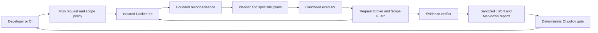

# GateCounsel

**An agent-assisted DevSecOps platform for continuous, scope-constrained web application security testing**

GateCounsel is a proposed academic prototype that explores how specialized AI agents can help select web security checks while deterministic controls keep testing limited to an explicitly authorized, isolated laboratory. The project combines application security, agent orchestration, evidence-based verification, and CI/CD feedback.

> **Project status:** This repository contains the public project overview. The application, Docker lab, and CI workflow are planned and are not implemented here yet. Detailed plans and supporting documents belong in the local, Git-ignored `Document_Plans_GitIgnored/` folder and are not published with this repository.

## The idea

Security checks are most useful when developers can run them repeatedly during development and receive clear, verifiable results. GateCounsel is intended to automate a bounded security assessment of a deliberately vulnerable web application in a local lab, then return findings and a policy decision to the development pipeline.

The system separates reasoning from action. Agents can analyze a mapped application surface and propose typed test plans. They do not make network requests. A deterministic request broker and Scope Guard check every action against the run's policy before approved tools can interact with the lab target. A verifier evaluates observed evidence; an agent's claim by itself does not establish a vulnerability.

The project will investigate whether vulnerability-class specialization improves useful findings, whether curated security knowledge improves test planning, and how strict scope enforcement can support safe CI/CD integration.

## Intended workflow

1. A developer or CI workflow starts a run with an explicit, versioned scope policy.
2. Docker Compose starts a deliberately vulnerable demo target on an isolated network and waits for its health check.
3. Bounded reconnaissance maps allowed pages, forms, routes, and relevant inputs.
4. A deterministic planner selects candidate checks. Specialist components return schema-validated plans for the selected vulnerability classes.
5. An executor sends each proposed action through a single request broker. The Scope Guard checks target, method, redirect, and run-budget constraints before a tool acts.
6. Class-specific verifiers compare the result with explicit success criteria and classify it as confirmed, rejected, or inconclusive.
7. The reporter writes sanitized JSON and Markdown findings. A deterministic policy gate returns a CI decision, and the workflow collects artifacts and removes the lab.

## MVP scope

The MVP roadmap narrows the broader project proposal to a small, reproducible demonstration:

| Area | Planned MVP |
|---|---|
| Target | One custom, deliberately vulnerable web application running in Docker |
| Vulnerability classes | Cross-Site Scripting (XSS) and Insecure Direct Object Reference (IDOR) |
| Planning | A rule-based planner and two specialist components with typed outputs |
| Reconnaissance | Bounded, same-origin browser exploration of known pages and inputs |
| Execution | One Python/Playwright executor using the request broker |
| Safety | Private Docker network, explicit scope policy, redirect checks, request and time budgets, and an audit log |
| Evidence and reports | Class-specific verification plus sanitized JSON and Markdown reports |
| DevSecOps integration | Docker Compose and a GitHub Actions workflow that runs the lab, collects artifacts, and cleans up |
| Interface | CLI or FastAPI's generated API documentation; no dashboard in the MVP |
| RAG and fine-tuning | Deferred until the controlled baseline is reliable |

SQL injection is a possible next step after XSS and IDOR work reliably end to end. The broader planning documents discuss additional vulnerability classes, retrieval-augmented generation, model fine-tuning, an API, and a dashboard as later research or extension work; they are not MVP commitments.

## Safety and authorization boundary

GateCounsel is intended only for targets that the project team owns or is explicitly authorized to test. The planned MVP uses a local, deliberately vulnerable target in an isolated Docker network. Public, third-party, and production targets are outside the project scope.

The core safety design is structural:

- Every outgoing request and browser navigation goes through one deterministic request broker and Scope Guard.
- The policy defines permitted hosts, addresses, ports, methods, redirects, expiry, and resource budgets.
- Agents produce structured plans but have no direct network or tool access.
- Execution is bounded, auditable, and restricted to the approved lab target.
- Reports and artifacts are sanitized to avoid exposing credentials, tokens, or other sensitive data.
- Findings require class-specific evidence; model output or confidence alone cannot confirm a vulnerability.

These are design requirements from the planning documents. They are not yet implemented or independently validated in this repository.

## Research questions and evaluation

The proposed evaluation asks:

1. Does routing a task to a vulnerability-class specialist improve useful findings compared with a generalist agent?
2. Does retrieval from curated security references improve plan quality compared with prompting alone?
3. Can deterministic scope and policy enforcement safely support agent-assisted checks in CI/CD?
4. Can change-aware planning reduce test time without reducing coverage of known benchmark cases?

The evaluation plan calls for a documented set of known positive and negative lab cases. Planned measures include confirmation or detection rate by vulnerability class, false-positive rate, time to first finding, and Scope Guard integrity. Results should be reported with the target version, test evidence, and run configuration so they can be reproduced. No evaluation results are claimed at this planning stage.

## Planned architecture and technology

The full roadmap recommends Python, Pydantic data contracts, LangGraph orchestration, FastAPI for a run API, Playwright for browser automation, Docker Compose for the lab, and GitHub Actions for CI/CD. A local retrieval store and model-provider abstraction are considered for later stages. The MVP can begin with a CLI and deterministic planning so that a model provider is not required for a repeatable run.

Technology choices remain proposals until implementation and validation. The project does not currently contain dependency manifests, runnable services, or a supported setup command.

## Repository contents

- `README.md` - public overview of the project concept, planned MVP, architecture, and safety boundaries.

Project planning files and supporting documents are intentionally excluded from Git. Keep internal roadmaps, research notes, PDFs, and document sources in the local `Document_Plans_GitIgnored/` folder. Git ignores PDF, TeX, and Markdown files throughout the repository, except for this README.

## First implementation milestone

The MVP is considered demonstrated when one local command or CI workflow can start the isolated lab, perform bounded reconnaissance, create typed plans for XSS and IDOR checks, execute them only through the scope-checked broker, confirm or reject controlled cases using evidence, publish sanitized reports, return a deterministic gate decision, and clean up the environment.

## Project team

The academic proposal names **Badr Laklach** and **Taha Benahmadi** as the project team. It places the work in the GI-ILSI academic context at ENSAM Meknès.
